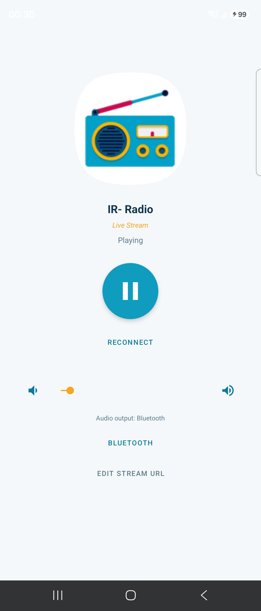
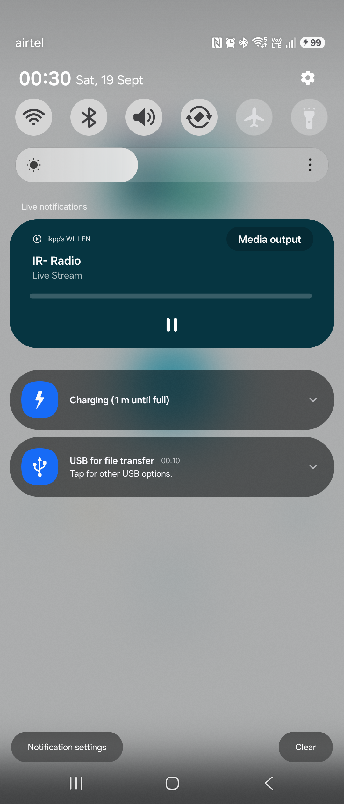

# IR- Radio

A small native Android app that plays a personal Icecast/Shoutcast-style radio stream (by
default, one hosted on a Raspberry Pi) with full playback controls, Bluetooth routing,
system volume integration, and a live "Now Playing" notification.

<p align="center">
  
</p>

| App | Live notification |
|---|---|
|  |  |

## Features

- **One-tap favorite stream** — launches and starts playing your saved stream automatically.
- **Full transport controls** — play/pause, reconnect (hard restart of the connection if the
  stream drops).
- **Volume controls** — an in-app slider plus +/- buttons, wired to the phone's music volume
  stream. Hardware volume buttons work as usual since the app uses the standard `STREAM_MUSIC`
  audio channel.
- **Bluetooth output** — playback automatically routes to any connected Bluetooth
  speaker/headphones (standard Android audio routing — no extra setup). The app also shows
  which output is currently active (phone speaker vs. Bluetooth) and has a shortcut button
  straight into Android's Bluetooth settings for pairing new devices.
- **Background playback** — playback continues after you leave the app, backed by a
  foreground `MediaSessionService` with a persistent notification, lock-screen controls, and
  Android's "Live Updates" media card (the Android equivalent of iOS's Dynamic Island —
  visible at the top of the notification shade while the stream is playing).
- **Now Playing song info** — if your stream server sends ICY/Shoutcast metadata
  (`StreamTitle`), the current track name is parsed automatically and shown both in the app
  and in the notification/live update card. If your stream doesn't send that metadata, the
  app just shows "Live Stream" instead — this is a property of the stream, not the app.
- **Editable stream URL** — tap **Edit Stream URL** (or long-press the station name) to change
  the station name and URL at any time, no rebuild/reinstall required. The new stream is
  saved and starts playing immediately, and will be used on every future app launch.

## Requirements

- Android 7.0 (API 24) or newer.
- The app must be able to reach the stream's host on the network (same Wi-Fi as your
  Raspberry Pi, a VPN back to your home network, etc.).

## Installing on a phone

### Option A — sideload the prebuilt APK from this repo

1. Download [`apk/IR-Radio.apk`](apk/IR-Radio.apk) to your phone.
2. Open it from your file manager / Downloads app. Android will prompt to allow installing
   from this source the first time — allow it.
3. Install, then open **IR- Radio**.

### Option B — install via adb from a computer

```bash
adb install -r apk/IR-Radio.apk
```

## Building from source

Requirements: JDK 17, Android SDK (`compileSdk`/`targetSdk` 37, `minSdk` 24), Gradle 9.x
(AGP 9's built-in Kotlin support is used, so no separate Kotlin Gradle plugin is required).

```bash
git clone https://github.com/ikppramesh/radioPlayer.git
cd radioPlayer
gradle assembleDebug
adb install -r app/build/outputs/apk/debug/app-debug.apk
```

`local.properties` (containing `sdk.dir=...`) is machine-specific and is not committed —
create your own pointing at your Android SDK location before building.

## Changing the default stream

The stream that ships with a fresh install/build is defined in
[`app/src/main/java/com/ramesh/piradio/Constants.kt`](app/src/main/java/com/ramesh/piradio/Constants.kt):

```kotlin
const val STREAM_URL = "http://raspberrypi.local:8000/radio.mp3"
const val STATION_NAME = "IR- Radio"
```

This is only the *default* used the very first time the app runs. After that, the app reads
the stream URL/name from its own local settings (`RadioPrefs`), which you can change any time
from inside the app via **Edit Stream URL** — no code change or reinstall needed.

## Network security note

Plain `http://` (cleartext) traffic is blocked by Android by default. Since the stream URL
can be changed at runtime to point at any host on your network, cleartext traffic is allowed
globally for this app (see
[`app/src/main/res/xml/network_security_config.xml`](app/src/main/res/xml/network_security_config.xml)).
This is fine for a personal utility app used only to reach devices on your own local network,
but keep in mind it means the app does not enforce HTTPS for any URL you point it at.

## Architecture

- **`PlaybackService`** — a `androidx.media3.session.MediaSessionService` that owns a single
  `ExoPlayer` instance and a `MediaSession`. This is what gives the app background playback,
  the system media notification/live update card, and automatic response to Bluetooth
  headset play/pause buttons — all for free from Media3, no custom notification or
  broadcast-receiver code needed.
- **`MainActivity`** — connects to the service via a `MediaController`, and only ever talks to
  the player through that controller (never touches ExoPlayer directly). This keeps playback
  alive independent of the activity's lifecycle.
- **`RadioPrefs`** — a thin `SharedPreferences` wrapper storing the current stream URL and
  display name, so the editable-stream feature persists across restarts.

## Changelog

### v1.3 — Now Playing metadata + live update card
- Surfaced ICY/Shoutcast `StreamTitle` metadata (when the stream provides it) in the app UI
  and in the system notification/live update card, alongside the fixed station name.
- Confirmed the media notification triggers Android's "Live Updates" status-bar/notification
  card automatically via `MediaSessionService` — the closest Android equivalent to iOS's
  Dynamic Island.

### v1.2 — Editable stream URL
- Added an in-app **Edit Stream URL** dialog (also reachable by long-pressing the station
  name) to change the station name/URL at runtime, persisted via `SharedPreferences`.
- Broadened the network security config to allow cleartext HTTP for any host, since the
  stream URL is no longer fixed at build time.

### v1.1 — Branding
- Renamed the default station label from "My Raspberry Pi Radio" to "IR- Radio".

### v1.0 — Initial release
- Native Kotlin app built on Media3 ExoPlayer with a `MediaSessionService` for background
  playback.
- Auto-plays the favorite stream (`http://raspberrypi.local:8000/radio.mp3`) on launch.
- Play/pause, reconnect, in-app volume slider + buttons wired to `STREAM_MUSIC`.
- Automatic Bluetooth audio routing plus an audio-output indicator and a shortcut into
  Android's Bluetooth settings.
- Custom app icon generated from a provided source image (legacy + adaptive icon variants).
- Network security config scoped to allow cleartext HTTP specifically for
  `raspberrypi.local` (superseded in v1.2, see above).

## License

Personal project — no license specified.
